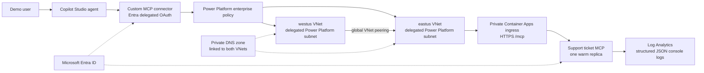

# Private MCP from Copilot Studio to Azure Container Apps

An end-to-end demo of Copilot Studio calling an **Entra ID-authenticated, private MCP server** through Power Platform virtual network support. The server is a mock support ticket service with fictional, in-memory data. No database or public MCP endpoint is deployed.

Terraform follows the [maf-harness-workiq style reference](https://github.com/scallighan/maf-harness-workiq/tree/main/terraform): pinned providers, `random_string` naming, shared locals/tags, focused resource files, managed identities, and a two-phase deployment with an immutable ACR image digest.

## Architecture



The default geography is **United States: eastus + westus**. Power Platform requires both delegated regional networks, including for nonproduction environments; selecting a single-region tab in the Microsoft article does **not** make the US a single-region geography. Both `/24` delegated subnets have the same size, private DNS links, and private routing to the server. Supported single-region geographies can instead set `TF_VAR_secondary_location=""` in `terraform/.env`; Terraform validates the region/geography combination.

The Container Apps environment uses an **internal load balancer** and disables public network access. The app's `external_enabled = true` permits traffic from outside the _Container Apps environment_, including the delegated Power Platform subnet; it does not expose the app to the internet when the environment is internal. This architecture needs no additional private endpoint or gateway.

Each VNet has a NAT gateway for explicit outbound access (Power Platform dependencies and public connectors, Entra signing keys, image pulls, and platform services). NAT public IPs provide outbound connectivity only. ACR's authenticated endpoint is public; the MCP endpoint is not. This is a private-ingress demo, not an outbound-isolated deployment.

## What the server does

| Tool            | Behavior                                                                        |
| --------------- | ------------------------------------------------------------------------------- |
| `list_tickets`  | List all tickets or filter by `open`, `inprogress`, `closed`                    |
| `get_ticket`    | Retrieve a ticket and its comments                                              |
| `create_ticket` | Create an open ticket with title, description, requester, and optional priority |
| `update_ticket` | Change status, priority, or assignee                                            |
| `add_comment`   | Append a comment with an author                                                 |

Seed tickets: `TKT-1001` is open (VPN issue), `TKT-1002` is in progress (laptop replacement), and `TKT-1003` is closed (password reset). Priorities are `low`, `normal`, `high`, and `urgent`.

All users share the same demo dataset. Writes survive independent MCP requests, but **not a process restart, replica replacement, or revision rollout**. One warm replica and single-revision mode minimize surprises; they do not make data durable or guarantee continuity during updates. MCP itself is stateless Streamable HTTP at `/mcp`, with JSON responses, no sticky sessions, and no legacy SSE endpoint. `/healthz` is an unauthenticated liveness endpoint inside the private network.

## Prerequisites

- An Azure subscription and Microsoft Entra tenant shared with your Power Platform environment.
- An existing, supported **Managed Power Platform environment**, Dataverse, and Copilot Studio access/licensing. Trial and Dataverse for Teams environments are unsupported. Use a dedicated demo environment: associating the policy changes networking for **all supported connectors and plugins** in that environment.
- Azure permissions to create resources, role assignments, and register providers (for example, Contributor plus Role Based Access Control Administrator). Permission to create/own Entra app registrations is also required.
- A Power Platform administrator to associate the enterprise policy. If this is a different person from the Azure deployer, set `power_platform_admin_object_ids` to grant Reader access on the policy.
- Terraform >= 1.11, Azure CLI with the `containerapp` extension, Node.js **24 LTS** (22.14+ also supported), npm, and Docker with a running Linux container daemon.
- PowerShell and `Microsoft.PowerPlatform.EnterprisePolicies` if using the policy-association script. The Power Platform admin center is an alternative.

Confirm your environment's actual Azure region pair with Microsoft's [VNet diagnostics guidance](https://learn.microsoft.com/en-us/troubleshoot/power-platform/administration/virtual-network) and `Get-EnvironmentRegion` before deployment. This demo defaults to the documented US eastus/westus pair and uses new, nonoverlapping `10.70.0.0/16` and `10.71.0.0/16` networks. Change `terraform/locals.tf` and the ACA subnet in `network.tf` before deploying if these overlap your network.

## 1. Run locally

```bash
npm ci
npm run typecheck
npm run lint
npm test
npm run build

# Local unauthenticated mode is allowed ONLY when bound to 127.0.0.1.
AUTH_MODE=none HOST=127.0.0.1 ALLOWED_HOSTS=127.0.0.1:8080 npm start
```

In another terminal:

```bash
npm run smoke
```

The smoke test uses the official MCP client to initialize, discover tools, create a ticket, move it to in progress, add a comment, close it, retrieve it, and list each status. It intentionally mutates the ephemeral dataset. `ALLOWED_HOSTS` contains exact HTTP Host values, including the port for local development; wildcards are not supported.

In deployed mode, authentication is mandatory. The server validates RS256 signatures against Entra's rotating JWKS, the tenant-specific v2 issuer, token expiration, the API's client ID as audience, the connector client ID (`azp`), and the delegated `Tickets.ReadWrite` scope. App-only tokens and tokens issued to Azure CLI or another client are rejected.

## 2. Provision and deploy

Sign in to the correct tenant/subscription and register resource providers:

```bash
az login --tenant YOUR_TENANT_ID
az account set --subscription YOUR_SUBSCRIPTION_ID
for provider in Microsoft.Network Microsoft.App Microsoft.ContainerService Microsoft.OperationalInsights Microsoft.ContainerRegistry Microsoft.ManagedIdentity Microsoft.PowerPlatform; do
  az provider register --namespace "$provider" --wait
done
az extension add --name containerapp --upgrade

cp terraform/env.sample terraform/.env
# Edit ARM_SUBSCRIPTION_ID and verify the geography/region pair.
set -a; source terraform/.env; set +a
bash scripts/deploy.sh
```

The `.env` file is git-ignored and must be sourced in each shell before running Terraform or the deployment script; the script does not load it automatically. If you remove a previously exported setting from `.env`, also `unset` that variable in the current shell or start a new shell. Terraform gives `terraform.tfvars` and `*.auto.tfvars.json` higher precedence than `TF_VAR_` environment variables. If you already created `terraform/terraform.tfvars`, migrate its inputs to `.env` and remove or rename that file yourself to avoid unexpected overrides. The deploy script's generated `mcp.auto.tfvars.json` intentionally remains the source of the image digest.

The deploy script:

1. Initializes Terraform and asks for confirmation before provisioning the platform, Entra apps, delegated networks, private DNS, and enterprise policy.
2. Builds a Linux/amd64 image locally, pushes it to ACR using your Azure identity, and resolves its immutable digest.
3. Persists the image in ignored `terraform/mcp.auto.tfvars.json`, then asks for confirmation before deploying/updating the app.
4. Generates `artifacts/support-tickets.swagger.json` and nonsecret `artifacts/connector-settings.json`, then waits for ACA's probes to mark the latest revision ready.

Your deploying identity also needs ACR push permission (normally inherited from Contributor for this non-ABAC registry). The app uses managed identity with `AcrPull`; there is no registry password. If a new role assignment has not propagated, wait and rerun the deployment.

If Azure rejects public IP creation with `SubscriptionNotRegisteredForFeature` for `Microsoft.Network/AllowBringYourOwnPublicIpAddress`, register that feature and re-register `Microsoft.Network`, then retry the apply:

```bash
az feature register --namespace Microsoft.Network --name AllowBringYourOwnPublicIpAddress
az feature show --namespace Microsoft.Network --name AllowBringYourOwnPublicIpAddress --query properties.state -o tsv
# Once the feature state is Registered:
az provider register --namespace Microsoft.Network --wait
```

All Azure resource provisioning is Terraform-managed. Policy association, Power Platform connection consent, and agent setup remain explicit Power Platform operations. The script does **not** silently enable VNet support on an environment or assume that a laptop can reach the private endpoint.

Rebuild/redeploy with `bash scripts/deploy.sh`. For Terraform-only updates, use:

```bash
terraform -chdir=terraform apply
# Regenerate the connector definition if endpoint/identity settings changed.
npx --no-install tsx scripts/render-connector.ts
```

Terraform state contains infrastructure and identity metadata; keep it private, and use an access-controlled remote backend when collaborating. No client secret is generated into Terraform state by this demo.

## 3. Associate the enterprise policy

Install the supported module once and link your **existing** Managed environment:

```powershell
Install-Module Microsoft.PowerPlatform.EnterprisePolicies -Scope CurrentUser
./scripts/link-environment.ps1 -EnvironmentId "YOUR-POWER-PLATFORM-ENVIRONMENT-GUID"
```

The script reads `enterprise_policy_id` from Terraform and calls Microsoft's `Enable-SubnetInjection`. Use `-WhatIf` to inspect the intended association. Alternatively, in the Power Platform admin center, go to **Security > Data and privacy > Azure Virtual Network policies**, choose the environment, and assign the Terraform-created policy.

Allow up to **30 minutes** for network initialization. In **Manage > Environments > your environment > History**, confirm the association succeeded before creating/testing connections.

## 4. Create the private MCP custom connector

Use the **same environment** you associated with the policy. A custom MCP connector makes the VNet-enabled connector path explicit; a standalone connector test is not a substitute for testing the agent.

1. Open Power Apps/Power Automate **Custom connectors > New custom connector > Import an OpenAPI file**. Import `artifacts/support-tickets.swagger.json`. Its `/mcp` operation includes `x-ms-agentic-protocol: mcp-streamable-1.0`.
2. On **General**, retain HTTPS, the generated `*.azurecontainerapps.io` host, and `/` base path. Do not select an on-premises data gateway.
3. On **Security**, choose **OAuth 2.0 > Azure Active Directory / Microsoft Entra ID**. Use `artifacts/connector-settings.json`: `client_id` for Client ID, `tenant_id` for Tenant ID (not `common`), and `resource_url` for Resource URL. If a scope field is shown, use the full `scope` value. The imported generic OAuth definition supplies v2 authorization/token endpoints; select the Entra provider in the UI when using managed identity authentication.
4. Choose **Managed identity** for the connector credential, then save/create the connector. Copy its generated **Redirect URL**, managed identity **issuer**, and **subject** exactly.
5. Add those nonsecret values to `terraform/.env`, using JSON for the list and object:

```bash
export TF_VAR_connector_redirect_uris='["EXACT-HTTPS-REDIRECT-URL-FROM-CONNECTOR"]'
export TF_VAR_connector_federation='{"issuer":"EXACT-ISSUER-FROM-CONNECTOR","subject":"EXACT-SUBJECT-FROM-CONNECTOR"}'
```

6. Reload the file with `set -a; source terraform/.env; set +a`, then run `terraform -chdir=terraform apply`. This configures the connector app's callback and federated identity credential with the `api://AzureADTokenExchange` audience. Terraform remains the owner of these settings, so later applies won't remove them.
7. Create a connection to the connector and sign in as your demo user. Complete any consent your tenant requires. If tenant policy blocks user consent, have an administrator grant consent for the connector app's delegated API permission.

Managed identity here authenticates the **connector OAuth client** without a client secret; it does not replace the signed-in user's delegated API token. See Microsoft's [managed identity connector authentication](https://learn.microsoft.com/en-us/connectors/custom-connectors/azure-active-directory-authentication#managed-identity-authentication).

**Client-secret alternative:** if managed identity authentication is unavailable in your environment, leave `TF_VAR_connector_federation` unset. Create a short-lived secret on the **connector** Entra app (not the API app) in the Entra portal, select client-secret authentication in the connector, and paste the secret there. Still copy the generated redirect URL into `TF_VAR_connector_redirect_uris`, reload `.env`, and apply Terraform. Never put the secret in Terraform variables, generated connector files, logs, or source control. Rotate/delete it after the demo.

## 5. Add the tool to Copilot Studio and demonstrate

Create/open an agent in that environment and enable generative orchestration. Under **Tools > Add a tool**, select the custom MCP connector and the authenticated connection; add it to the agent. Depending on the portal version, find it under the Model Context Protocol or connector filters. Ensure environment data policies allow this custom connector and that the connection is shared/configured for your intended test users.

Suggested agent instructions:

> You are a demo support assistant. Use the private support ticket tools for all ticket information and changes. All records must be fictional. Confirm the user's intended ticket before making changes. Report the ticket ID and resulting status. Data is shared demo data and may reset at any time.

Use the test chat:

```text
List open support tickets.
Show TKT-1001 including its comments.
Create a high-priority ticket for Demo User: "Demo laptop cannot connect to VPN".
Move that new ticket to inprogress and assign it to Demo Support.
Add a comment to the new ticket: "Private connectivity verified from Copilot Studio".
Close the new ticket, then list closed tickets.
```

Check the tool invocation details in the agent test pane and the server logs. The new ticket should appear in later calls and have the comment and closed status. A successful response **from the agent**, paired with the server's `auth_success` and `mcp_tool` events, verifies the full private path and delegated authentication.

This repository does not create/publish an agent, enable Managed Environments, or grant tenant-wide administrator consent automatically. These are tenant/environment-specific setup steps, not missing Azure infrastructure.

## 6. Inspect request headers and prove private connectivity

Stream live console logs:

```bash
SUBSCRIPTION_ID="$(terraform -chdir=terraform output -raw subscription_id)"
RESOURCE_GROUP="$(terraform -chdir=terraform output -raw resource_group_name)"
APP_NAME="$(terraform -chdir=terraform output -raw container_app_name)"
az containerapp logs show --subscription "$SUBSCRIPTION_ID" \
  --resource-group "$RESOURCE_GROUP" --name "$APP_NAME" --type console --follow
```

Each request has a server-generated `request_id`, returned as `x-request-id`. Events include:

- `http_request`: method, path, peer address, and HTTP version.
- `http_header`: **every header received by Node**, preserving original names and duplicate values; one log line per header. Inspect forwarded addresses, `traceparent`, user agent, and any Power Platform correlation headers actually present.
- `http_response`, `auth_success` / `auth_denied`, and `mcp_tool`: status, latency, client/tenant, tool name, and outcome.

Header names matching authorization, cookies, tokens, keys, secrets, credentials, assertions, signatures, certificates, or encoded client principals have their **values redacted**. Other values are capped at 2,048 characters and marked `truncated` when necessary. The HTTP server accepts up to 16 KiB of headers. Request bodies, query strings, bearer-token claims containing user identifiers, and ticket/comment content are not deliberately logged. Do not send secrets in arbitrary noncredential headers. Ingress can remove/rewrite headers; the service cannot log headers it never receives. The peer address is normally the ingress proxy, not the originating user.

In the Log Analytics workspace, run:

```kusto
ContainerAppConsoleLogs_CL
| where TimeGenerated > ago(30m)
| extend entry = parse_json(Log_s)
| where entry.event in ("http_request", "http_header", "http_response", "auth_success", "auth_denied", "mcp_tool")
| project TimeGenerated, ContainerAppName_s,
          event=tostring(entry.event), request_id=tostring(entry.request_id),
          header=tostring(entry.name), value=tostring(entry.value),
          tool=tostring(entry.tool), status=tostring(entry.status), outcome=tostring(entry.outcome)
| order by TimeGenerated asc
```

Filter on a `request_id` to join the headers, authorization result, and tool invocation. Log ingestion can lag. Requests to `/healthz`, including ACA probes, are omitted from request logs.

For private-network checks, use a VM/runner on either VNet (not the reserved delegated subnets), or your existing connected network with a DNS forwarding path to Azure Private DNS:

```bash
MCP_URL="$(terraform -chdir=terraform output -raw mcp_endpoint)"
HOSTNAME="$(node -e 'console.log(new URL(process.argv[1]).hostname)' "$MCP_URL")"
getent hosts "$HOSTNAME"
# Must resolve to Terraform's internal_ip_address.
curl --fail --show-error --silent "https://$HOSTNAME/healthz"
# No token: expect 401 from the application, demonstrating private reachability.
curl --include --request POST "$MCP_URL" \
  --header 'Content-Type: application/json' --data '{}'
```

From an ordinary internet-only machine, the private app must **not** be reachable. DNS alone is not proof; a reachable HTTP response from an off-VNet machine merits checking the environment's ingress settings and your machine's VPN/routes. A laptop needs VPN/ExpressRoute and appropriate DNS forwarding; the deployment script deliberately doesn't expose the service to make laptop tests work.

`npm run smoke` also accepts `MCP_URL` and `MCP_BEARER_TOKEN` from the process environment for an authenticated private runner. That token must be a delegated token for this API **issued to this connector client**. A normal `az account get-access-token` token won't pass the client restriction. For the standard demo, use the Copilot Studio connection rather than extracting its token.

## Troubleshooting

| Symptom                                   | Check                                                                                                                                                                  |
| ----------------------------------------- | ---------------------------------------------------------------------------------------------------------------------------------------------------------------------- |
| Policy association fails                  | Managed/supported environment, matching tenant/geography and actual region pair, both subnet delegations, policy Reader access, and Power Platform admin permissions   |
| Private hostname doesn't resolve          | Private DNS zone and wildcard record, links to both VNets, and DNS forwarding for any VPN/on-premises client                                                           |
| DNS works but connections time out        | Policy association completion, VNet peering in both directions, routing/NSGs, and the internal ingress IP; do not make ingress public                                  |
| HTTP 401                                  | Expired/missing token, v1 token instead of v2, wrong issuer/audience, or invalid signature; inspect `auth_denied`                                                      |
| HTTP 403                                  | Wrong OAuth client, missing delegated `Tickets.ReadWrite`, app-only token, or an unexpected HTTP Host value                                                            |
| OAuth redirect mismatch                   | Copy the exact generated callback URL into `TF_VAR_connector_redirect_uris`, reload `.env`, and apply Terraform                                                        |
| OAuth client assertion/credential failure | Copy the connector's exact federation issuer/subject and verify audience, or check the alternative client secret hasn't expired                                        |
| Tools don't appear                        | Imported `x-ms-agentic-protocol`, correct `/mcp` path, Streamable HTTP rather than legacy SSE, data policy, and a valid connection in the same VNet-linked environment |
| Image pull fails                          | Deploying user's ACR push access, app identity's `AcrPull` propagation, registry hostname/digest, and ACA outbound access                                              |
| Other connectors stop working             | VNet support affects the whole environment; check outbound NAT, data policies, and Microsoft prerequisites                                                             |
| Ticket disappeared                        | Process/revision restarted; all writes are intentionally ephemeral                                                                                                     |

## Validation and cleanup

```bash
npm ci
npm run typecheck && npm run lint && npm run format:check && npm test && npm run build
bash -n scripts/deploy.sh
terraform -chdir=terraform init -backend=false -input=false
terraform -chdir=terraform fmt -check -recursive
terraform -chdir=terraform validate
terraform -chdir=terraform test
docker build -t support-tickets:test .
```

Tests exercise the real Streamable HTTP client/server, ticket lifecycle and reset behavior, invalid inputs, redacted header telemetry, malformed requests/Host checks, and locally signed JWTs with signature/issuer/audience/expiry/client/scope rejection cases. Terraform tests use mocked providers: they verify private ingress, regional policy topology, bootstrap behavior, and single-replica authenticated deployment **without creating Azure resources**. CI runs these checks and builds the container. Live Azure reachability and Copilot Studio consent/tool execution require completing the tenant setup above.

To clean up, first remove the tool/connection/custom connector from Power Platform and **detach the enterprise policy before destroying its subnets**:

```powershell
Import-Module Microsoft.PowerPlatform.EnterprisePolicies
Disable-SubnetInjection -EnvironmentId "YOUR-POWER-PLATFORM-ENVIRONMENT-GUID"
```

Wait for successful detachment, then:

```bash
terraform -chdir=terraform destroy
```

If you created an alternative client secret, remove it too. The default deployment incurs ongoing charges for NAT gateways/public IPs, ACR, one warm ACA replica, and Log Analytics (plus applicable peering and Power Platform licensing). Tear it down when finished; keeping one replica warm is intentional for the in-memory demo.

## References

- [Power Platform VNet overview and supported regions](https://learn.microsoft.com/en-us/power-platform/admin/vnet-support-overview)
- [Set up VNet support, enterprise policies, and environment association](https://learn.microsoft.com/en-us/power-platform/admin/vnet-support-setup-configure?tabs=existing%2Csingle&pivots=powershell)
- [Connect an existing MCP server to Copilot Studio](https://learn.microsoft.com/en-us/microsoft-copilot-studio/mcp-add-existing-server-to-agent)
- [Entra authentication for custom connectors](https://learn.microsoft.com/en-us/connectors/custom-connectors/azure-active-directory-authentication)
- [Container Apps custom VNet integration](https://learn.microsoft.com/en-us/azure/container-apps/vnet-custom)
- [Terraform style reference](https://github.com/scallighan/maf-harness-workiq/tree/main/terraform)
